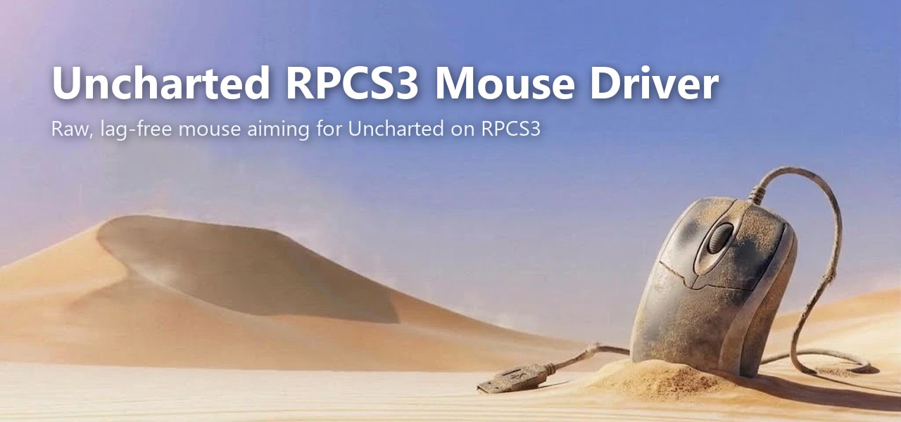

Raw mouse aiming for **Uncharted 3: Drake's Deception** (update 1.19) on **RPCS3**. It replaces the emulated right stick with direct mouse input: no deadzone, no acceleration, no smoothing, and the same sensitivity at any frame rate.

## Install

1. Download `UnchartedMouseAim.exe` from [Releases](../../releases) and put it next to `rpcs3.exe`.
2. Stop all running RPCS3 processes.
3. Run `UnchartedMouseAim.exe`. It installs the **UC3 Mouse Aim** patch and enables it in the RPCS3 config.
4. Start RPCS3 and load the game. Make sure the patch is enabled in **Manage → Game Patches**.
5. For keyboard controls, use RPCS3's normal keyboard-to-pad mapping.
6. In the program, choose **3) Start mouse aim** and keep its window open.

If the game is ever started without the patch, the program enables it again by itself. It then asks you to restart RPCS3.

Supported versions: BCES01175/01176/01670/01692, BCUS98233/99086, BCJS37004, BCAS25009/25014, NPEA00422, NPUA80858, all on update 1.19.

## Troubleshooting

| Status | Fix |
|---|---|
| `running WITHOUT the patch` | The patch has been re-enabled. Close RPCS3, start it again and load the game. |
| `memory cannot be accessed` | RPCS3 runs as administrator. Run this program as administrator too. |

## How it works

**Patch:**
- Removes the game's stick processing: deadzone, response curve, direction-reversal filter and magnitude clamp.
- Removes aim acceleration, aim assist and slowdown.
- Removes the free-look turn ramp, axis snapping and camera spring.
- Adds a routine to gamepad polling. Every frame it takes the mouse movement since the last frame and divides it by the game's frame time. The game then multiplies by the same frame time, so **rotation = counts × scale** at any FPS.

**Program:**
- Reads Windows Raw Input (unaccelerated sensor counts) and adds each event to a running total in game memory. A running total cannot drop or double movement between frames.
- While the right mouse button is held, it uses the separate aiming sensitivity from the program's settings.
- Checks the game's code to tell whether the game was booted with the patch.
- Input is sent only while the game window has focus. Then the cursor is hidden and kept in the window's centre.

## Build

```bat
pip install pyinstaller
build.bat
```

To run without building, use `python uncharted_mouse_aim.py` (Python 3.9+, no dependencies). The patch is also included as a YAML file in this repository, for importing by hand in *Manage → Game Patches*.

## Game support

| Game | Status |
|---|---|
| Uncharted: Drake's Fortune | Planned |
| Uncharted 2: Among Thieves | Planned |
| Uncharted 3: Drake's Deception (update 1.19) | Supported, not fully tested |

## Ghidra

If you want to dig into the game code yourself, the `decomp` folder has my Ghidra work on the 1.19 executable: function names, comments, variables and structs for the camera, aiming and input code. It contains no game code.

1. Import your own decrypted `EBOOT.elf` into Ghidra (language `PowerPC:BE:64:A2ALT-32addr`).
2. Add the `decomp` folder in the Script Manager and run `ApplyUC3Annotations`. It checks the ELF hash first.

## Legal and copyright

- **No game content.** This repository and its releases contain no code, executables, assets, keys or decrypted files from Uncharted 3 or any other Sony software. Everything here is original work: the mouse driver, the patch instructions and the Ghidra notes.
- **Bring your own copy.** To use the patch or the Ghidra notes you need your own legally purchased copy of the game, dumped and decrypted yourself. Nothing here helps with obtaining, decrypting or sharing game files.
- **Trademarks.** *Uncharted* is a trademark of Sony Interactive Entertainment, and the game is developed by Naughty Dog. RPCS3 is an independent open-source project. Their names are used only to describe compatibility.
- **Not affiliated.** This is a non-commercial fan project. It is not affiliated with, endorsed by or supported by Sony Interactive Entertainment, Naughty Dog or the RPCS3 team.
- **No warranty.** The software is provided "as is". Use it at your own risk.

If you are a rights holder and believe something here should not be published, please open an issue and it will be reviewed and removed if needed.
